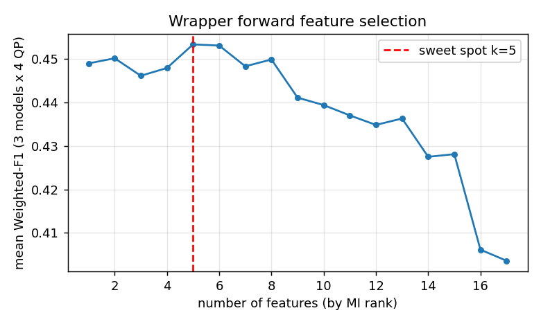
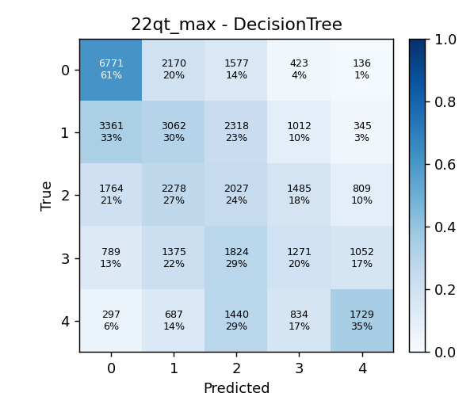
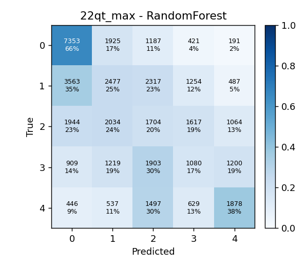
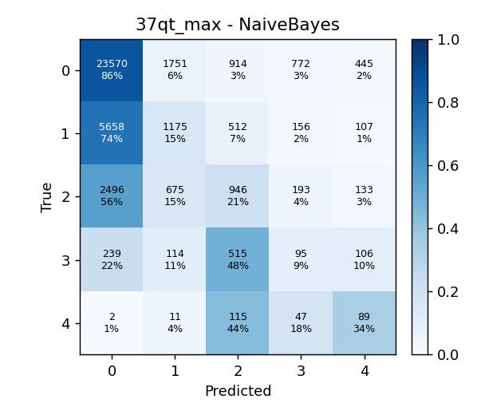
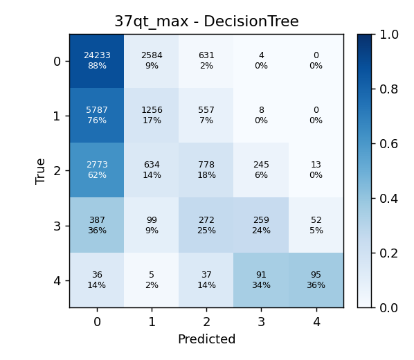

# 模型训练报告 —— QT 划分深度预测

> 生成时间 2026-06-03 21:40 · 输入 `Training.csv` · GroupKFold(5, 按序列) · 多分类 qt_max(0–4)

## 1. 数据概览

- 原始行数：40836
- 清洗后行数：40836（丢弃含 NaN/Inf 行 0，重复行 0 仅统计未删）
- 序列数（分组用）：21

各 QP 下 qt_max 类别分布：

| QP | qt=0 | qt=1 | qt=2 | qt=3 | qt=4 | 合计 |
|----|----|----|----|----|----|----|
| 22qt_max | 11077 | 10098 | 8363 | 6311 | 4987 | 40836 |
| 27qt_max | 19408 | 7858 | 6763 | 4655 | 2152 | 40836 |
| 32qt_max | 23872 | 7187 | 6516 | 2500 | 761 | 40836 |
| 37qt_max | 27452 | 7608 | 4443 | 1069 | 264 | 40836 |

## 2. 数据清洗

- 把 ±Inf 视作缺失，连同 NaN 一并按特征/标签列删除（Training.csv 已基本干净，此处兜底）。
- 标签列四舍五入取整为类别。重复行仅统计，不删除（不同 CTU 偶有完全相同的特征也属正常）。

## 3. 特征筛选

- 预处理：剔除近常量特征 无；剔除高相关冗余（|corr|>0.95） ['Lap_kurt']。
- 方法：**wrapper 甜蜜点 k=5**。最终选用 **5** 个空域特征。
- 选用空域特征（5 个）：['Sobel_mean', 'Sobel_std', 'Lap_std', 'std', 'Lap_mean']
- **QP-value 为必选特征，不参与 wrapper 选择**：每个 QP 的模型固定额外加入它自己的 QP-value（22qt_max→22QP，27→27QP，32→32QP，37→37QP；与 VTM 部署时的用法一致），wrapper 只在空域特征里挑。
- **因此每个 QP 的模型最终只用 5 个空域特征 + 1 个匹配 QP-value = 6 个特征**，实际编码时计算开销很小。

### 3.1 包裹式前向选择（甜蜜点）

按平均互信息从高到低逐个加入特征，每步用 3 个模型 × 4 个 QP 的平均 Weighted-F1 评估；取**性能达到峰值−容差**的最小特征数为甜蜜点。

峰值平均 Weighted-F1 = 0.4534，容差 = 0.003，**甜蜜点 k = 5**（即只保留前 5 个特征）。

| k | 新加入特征 | 平均 Weighted-F1 | 是否保留 |
|---|------------|------------------|----------|
| 1 | Sobel_mean | 0.4490 | ✅ |
| 2 | Sobel_std | 0.4502 | ✅ |
| 3 | Lap_std | 0.4462 | ✅ |
| 4 | std | 0.4480 | ✅ |
| 5 | Lap_mean | 0.4534 | ✅ |
| 6 | Lap_skew | 0.4531 |  |
| 7 | LapLevene | 0.4483 |  |
| 8 | LapKrusW | 0.4499 |  |
| 9 | Sobel_kurt | 0.4411 |  |
| 10 | Sobel_skew | 0.4394 |  |
| 11 | mean | 0.4370 |  |
| 12 | LeveneTest | 0.4349 |  |
| 13 | SobelKrusW | 0.4363 |  |
| 14 | skew | 0.4275 |  |
| 15 | SobelLevene | 0.4281 |  |
| 16 | kurt | 0.4062 |  |
| 17 | KrusWTest | 0.4036 |  |

全部候选特征对标签的互信息（越大越有判别力，按平均 MI 降序）：

| 特征 | 平均MI | 22qt_max | 27qt_max | 32qt_max | 37qt_max |
|------|--------|------|------|------|------|
| Sobel_mean | 0.118 | 0.189 | 0.125 | 0.086 | 0.072 |
| Sobel_std | 0.114 | 0.178 | 0.118 | 0.088 | 0.073 |
| Lap_std | 0.087 | 0.157 | 0.080 | 0.059 | 0.053 |
| std | 0.082 | 0.131 | 0.079 | 0.069 | 0.052 |
| Lap_mean | 0.072 | 0.117 | 0.077 | 0.053 | 0.040 |
| Lap_skew | 0.070 | 0.095 | 0.080 | 0.060 | 0.045 |
| LapLevene | 0.041 | 0.060 | 0.037 | 0.033 | 0.032 |
| LapKrusW | 0.040 | 0.042 | 0.042 | 0.039 | 0.037 |
| Sobel_kurt | 0.038 | 0.049 | 0.049 | 0.030 | 0.026 |
| Sobel_skew | 0.038 | 0.055 | 0.053 | 0.022 | 0.019 |
| mean | 0.035 | 0.054 | 0.039 | 0.023 | 0.024 |
| LeveneTest | 0.026 | 0.054 | 0.028 | 0.013 | 0.009 |
| SobelKrusW | 0.022 | 0.030 | 0.019 | 0.016 | 0.024 |
| skew | 0.021 | 0.034 | 0.026 | 0.015 | 0.010 |
| SobelLevene | 0.020 | 0.027 | 0.021 | 0.019 | 0.014 |
| kurt | 0.014 | 0.038 | 0.010 | 0.004 | 0.003 |
| KrusWTest | 0.006 | 0.014 | 0.011 | 0.000 | 0.001 |

## 4. 模型评估（每个 QP × 3 个模型）

指标均为 5 折分组交叉验证的折外（out-of-fold）结果：

### 22qt_max

| 模型 | 准确率 | CV准确率(均值±std) | Macro-F1 | Weighted-F1 |
|------|--------|--------------------|----------|-------------|
| NaiveBayes | 0.3514 | 0.3522±0.0959 | 0.3040 | 0.3229 |
| DecisionTree | 0.3639 | 0.3646±0.0472 | 0.3422 | 0.3583 |
| RandomForest | 0.3549 | 0.3562±0.0639 | 0.3254 | 0.3421 |

该 QP 下 Weighted-F1 最高：**DecisionTree**

混淆矩阵（行=真实，列=预测，格内为计数与行归一化%）：

- NaiveBayes：
- DecisionTree：
- RandomForest：

### 27qt_max

| 模型 | 准确率 | CV准确率(均值±std) | Macro-F1 | Weighted-F1 |
|------|--------|--------------------|----------|-------------|
| NaiveBayes | 0.4666 | 0.4671±0.1050 | 0.2750 | 0.4073 |
| DecisionTree | 0.4579 | 0.4583±0.0756 | 0.3128 | 0.4292 |
| RandomForest | 0.4737 | 0.4734±0.1048 | 0.3005 | 0.4177 |

该 QP 下 Weighted-F1 最高：**DecisionTree**

混淆矩阵（行=真实，列=预测，格内为计数与行归一化%）：

- NaiveBayes：
- DecisionTree：
- RandomForest：

### 32qt_max

| 模型 | 准确率 | CV准确率(均值±std) | Macro-F1 | Weighted-F1 |
|------|--------|--------------------|----------|-------------|
| NaiveBayes | 0.5479 | 0.5487±0.1138 | 0.2874 | 0.5008 |
| DecisionTree | 0.5629 | 0.5637±0.1066 | 0.3364 | 0.5159 |
| RandomForest | 0.5861 | 0.5870±0.1258 | 0.3281 | 0.5104 |

该 QP 下 Weighted-F1 最高：**DecisionTree**

混淆矩阵（行=真实，列=预测，格内为计数与行归一化%）：

- NaiveBayes：
- DecisionTree：
- RandomForest：

### 37qt_max

| 模型 | 准确率 | CV准确率(均值±std) | Macro-F1 | Weighted-F1 |
|------|--------|--------------------|----------|-------------|
| NaiveBayes | 0.6336 | 0.6350±0.1207 | 0.2984 | 0.6028 |
| DecisionTree | 0.6519 | 0.6531±0.1184 | 0.3988 | 0.6116 |
| RandomForest | 0.6788 | 0.6806±0.1344 | 0.3797 | 0.6140 |

该 QP 下 Weighted-F1 最高：**RandomForest**

混淆矩阵（行=真实，列=预测，格内为计数与行归一化%）：

- NaiveBayes：
- DecisionTree：
- RandomForest：

## 5. 汇总

各 QP × 模型的 Weighted-F1：

| QP | DecisionTree | NaiveBayes | RandomForest |
|----|----|----|----|
| 22qt_max | 0.3583 | 0.3229 | 0.3421 |
| 27qt_max | 0.4292 | 0.4073 | 0.4177 |
| 32qt_max | 0.5159 | 0.5008 | 0.5104 |
| 37qt_max | 0.6116 | 0.6028 | 0.6140 |

- 跨 4 个 QP 平均 Weighted-F1 最高的模型：**DecisionTree**
- 注意：本评估按**序列分组**交叉验证，反映对“没见过的视频”的泛化；若改成随机分层折，指标通常会更高但偏乐观。

## 6. 模型选择与已保存模型（供嵌入 VTM）

**选择策略**：在**算法层面**选——比较每种算法在 4 个 QP 上的平均 Weighted-F1，平均最高的那一种作为最终算法（而非每个 QP 各挑各的，保证部署时只用一种模型）。

各算法跨 4 个 QP 的平均 Weighted-F1：

| 算法 | 平均 Weighted-F1 |
|------|------------------|
| DecisionTree | 0.4788 ✅ 最终选用 |
| RandomForest | 0.4710 |
| NaiveBayes | 0.4585 |

**最终算法：DecisionTree**（叶子最小样本数 = 50，已限制规模）。用它在每个 QP 上各训一个模型、在**全量数据**上重训，并**训练时直接序列化**进一个C++(VTM) 可读的森林文件：

| QP | 模型 | Weighted-F1 |
|----|------|-------------|
| 22qt_max | DecisionTree | 0.3583 |
| 27qt_max | DecisionTree | 0.4292 |
| 32qt_max | DecisionTree | 0.5159 |
| 37qt_max | DecisionTree | 0.6116 |

- **VTM 模型**：`qtForest.bin`（4 个 QP 的森林合一），编码时设 `QT_FOREST_MODEL` 指向它即可。
- 每个 QP 另有 `models/<qp>.json` 记录特征顺序/类别/指标（仅供人看，VTM 只读 bin）。
- 特征顺序末尾即匹配的 QP-value；嵌入推理时按此顺序喂入。

