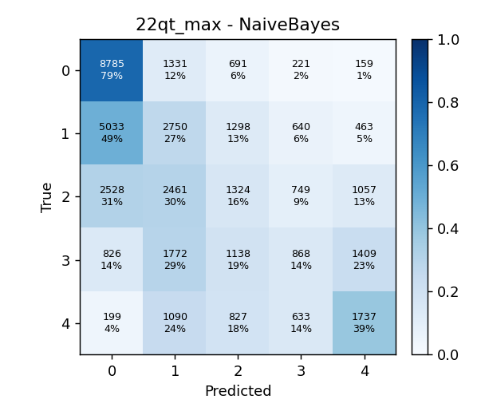
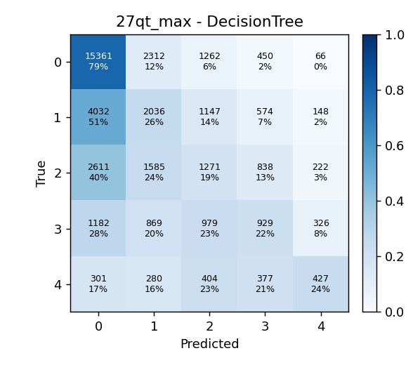
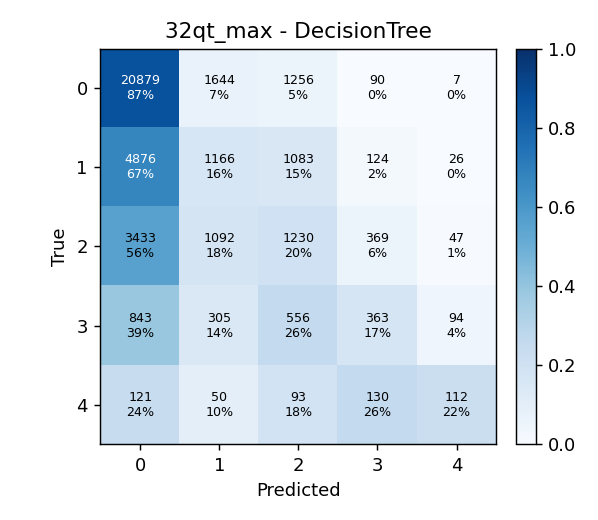

# 模型训练报告 —— QT 划分深度预测

> 生成时间 2026-06-25 17:09 · 输入 `Training.csv` · GroupKFold(5, 按序列) · 多分类 qt_max(0–4)

## 1. 数据概览

- 原始行数：39989
- 清洗后行数：39989（丢弃含 NaN/Inf 行 0，重复行 0 仅统计未删）
- 序列数（分组用）：21

各 QP 下 qt_max 类别分布：

| QP | qt=0 | qt=1 | qt=2 | qt=3 | qt=4 | 合计 |
|----|----|----|----|----|----|----|
| 22qt_max | 11187 | 10184 | 8119 | 6013 | 4486 | 39989 |
| 27qt_max | 19451 | 7937 | 6527 | 4285 | 1789 | 39989 |
| 32qt_max | 23876 | 7275 | 6171 | 2161 | 506 | 39989 |
| 37qt_max | 27556 | 7594 | 3985 | 692 | 162 | 39989 |

## 2. 数据清洗

- 把 ±Inf 视作缺失，连同 NaN 一并按特征/标签列删除（Training.csv 已基本干净，此处兜底）。
- 标签列四舍五入取整为类别。重复行仅统计，不删除（不同 CTU 偶有完全相同的特征也属正常）。

## 3. 特征筛选

- 预处理：剔除近常量特征 无；剔除高相关冗余（|corr|>0.95） ['Lap_kurt']。
- 方法：**wrapper 甜蜜点 k=3**。最终选用 **3** 个空域特征。
- 选用空域特征（3 个）：['res_std', 'Sobel_std', 'Sobel_mean']
- **QP-value 为必选特征，不参与 wrapper 选择**：每个 QP 的模型固定额外加入它自己的 QP-value（22qt_max→22QP，27→27QP，32→32QP，37→37QP；与 VTM 部署时的用法一致），wrapper 只在空域特征里挑。
- **因此每个 QP 的模型最终只用 3 个空域特征 + 1 个匹配 QP-value = 4 个特征**，实际编码时计算开销很小。

### 3.1 包裹式前向选择（甜蜜点）

按平均互信息从高到低逐个加入特征，每步用 3 个模型 × 4 个 QP 的平均 Weighted-F1 评估；取**性能达到峰值−容差**的最小特征数为甜蜜点。

峰值平均 Weighted-F1 = 0.5000，容差 = 0.003，**甜蜜点 k = 3**（即只保留前 3 个特征）。

| k | 新加入特征 | 平均 Weighted-F1 | 是否保留 |
|---|------------|------------------|----------|
| 1 | res_std | 0.4894 | ✅ |
| 2 | Sobel_std | 0.4930 | ✅ |
| 3 | Sobel_mean | 0.4995 | ✅ |
| 4 | res_mean | 0.4980 |  |
| 5 | std | 0.4960 |  |
| 6 | Lap_skew | 0.5000 |  |
| 7 | Lap_std | 0.4991 |  |
| 8 | Lap_mean | 0.4981 |  |
| 9 | res_kurt | 0.4713 |  |
| 10 | Sobel_skew | 0.4665 |  |
| 11 | res_skew | 0.4580 |  |
| 12 | Sobel_kurt | 0.4490 |  |
| 13 | mean | 0.4467 |  |
| 14 | LapLevene | 0.4447 |  |
| 15 | LapKrusW | 0.4474 |  |
| 16 | SobelLevene | 0.4466 |  |
| 17 | skew | 0.4479 |  |
| 18 | kurt | 0.4408 |  |
| 19 | SobelKrusW | 0.4396 |  |
| 20 | LeveneTest | 0.4384 |  |
| 21 | KrusWTest | 0.4374 |  |

全部候选特征对标签的互信息（越大越有判别力，按平均 MI 降序）：

| 特征 | 平均MI | 22qt_max | 27qt_max | 32qt_max | 37qt_max |
|------|--------|------|------|------|------|
| res_std | 0.226 | 0.270 | 0.236 | 0.213 | 0.187 |
| Sobel_std | 0.130 | 0.192 | 0.134 | 0.105 | 0.090 |
| Sobel_mean | 0.120 | 0.181 | 0.129 | 0.097 | 0.074 |
| res_mean | 0.117 | 0.103 | 0.128 | 0.118 | 0.118 |
| std | 0.095 | 0.143 | 0.095 | 0.076 | 0.066 |
| Lap_skew | 0.084 | 0.106 | 0.091 | 0.080 | 0.058 |
| Lap_std | 0.081 | 0.143 | 0.069 | 0.066 | 0.045 |
| Lap_mean | 0.072 | 0.121 | 0.065 | 0.054 | 0.047 |
| res_kurt | 0.059 | 0.094 | 0.060 | 0.048 | 0.032 |
| Sobel_skew | 0.048 | 0.070 | 0.044 | 0.050 | 0.029 |
| res_skew | 0.043 | 0.061 | 0.047 | 0.033 | 0.029 |
| Sobel_kurt | 0.039 | 0.051 | 0.040 | 0.036 | 0.028 |
| mean | 0.039 | 0.061 | 0.031 | 0.034 | 0.030 |
| LapLevene | 0.036 | 0.051 | 0.036 | 0.027 | 0.030 |
| LapKrusW | 0.034 | 0.041 | 0.032 | 0.035 | 0.027 |
| SobelLevene | 0.030 | 0.051 | 0.029 | 0.020 | 0.019 |
| skew | 0.026 | 0.040 | 0.029 | 0.020 | 0.016 |
| kurt | 0.020 | 0.034 | 0.029 | 0.008 | 0.011 |
| SobelKrusW | 0.017 | 0.037 | 0.012 | 0.008 | 0.012 |
| LeveneTest | 0.016 | 0.023 | 0.022 | 0.013 | 0.004 |
| KrusWTest | 0.001 | 0.006 | 0.000 | 0.000 | 0.000 |

## 4. 模型评估（每个 QP × 3 个模型）

指标均为 5 折分组交叉验证的折外（out-of-fold）结果：

### 22qt_max

| 模型 | 准确率 | CV准确率(均值±std) | Macro-F1 | Weighted-F1 |
|------|--------|--------------------|----------|-------------|
| NaiveBayes | 0.3867 | 0.3866±0.0282 | 0.3314 | 0.3542 |
| DecisionTree | 0.4004 | 0.4000±0.0304 | 0.3630 | 0.3959 |
| RandomForest | 0.4152 | 0.4150±0.0388 | 0.3743 | 0.4075 |

该 QP 下 Weighted-F1 最高：**RandomForest**

混淆矩阵（行=真实，列=预测，格内为计数与行归一化%）：

- NaiveBayes：
- DecisionTree：
- RandomForest：

### 27qt_max

| 模型 | 准确率 | CV准确率(均值±std) | Macro-F1 | Weighted-F1 |
|------|--------|--------------------|----------|-------------|
| NaiveBayes | 0.4986 | 0.4983±0.0588 | 0.3177 | 0.4512 |
| DecisionTree | 0.5007 | 0.5001±0.0551 | 0.3484 | 0.4772 |
| RandomForest | 0.5129 | 0.5126±0.0543 | 0.3429 | 0.4707 |

该 QP 下 Weighted-F1 最高：**DecisionTree**

混淆矩阵（行=真实，列=预测，格内为计数与行归一化%）：

- NaiveBayes：
- DecisionTree：
- RandomForest：

### 32qt_max

| 模型 | 准确率 | CV准确率(均值±std) | Macro-F1 | Weighted-F1 |
|------|--------|--------------------|----------|-------------|
| NaiveBayes | 0.5806 | 0.5807±0.0624 | 0.3179 | 0.5457 |
| DecisionTree | 0.5939 | 0.5944±0.0560 | 0.3438 | 0.5505 |
| RandomForest | 0.6050 | 0.6055±0.0500 | 0.3332 | 0.5478 |

该 QP 下 Weighted-F1 最高：**DecisionTree**

混淆矩阵（行=真实，列=预测，格内为计数与行归一化%）：

- NaiveBayes：
- DecisionTree：
- RandomForest：

### 37qt_max

| 模型 | 准确率 | CV准确率(均值±std) | Macro-F1 | Weighted-F1 |
|------|--------|--------------------|----------|-------------|
| NaiveBayes | 0.6727 | 0.6732±0.0603 | 0.3446 | 0.6522 |
| DecisionTree | 0.6859 | 0.6870±0.0496 | 0.3249 | 0.6475 |
| RandomForest | 0.6952 | 0.6964±0.0532 | 0.3047 | 0.6437 |

该 QP 下 Weighted-F1 最高：**NaiveBayes**

混淆矩阵（行=真实，列=预测，格内为计数与行归一化%）：

- NaiveBayes：
- DecisionTree：
- RandomForest：

## 5. 汇总

各 QP × 模型的 Weighted-F1：

| QP | DecisionTree | NaiveBayes | RandomForest |
|----|----|----|----|
| 22qt_max | 0.3959 | 0.3542 | 0.4075 |
| 27qt_max | 0.4772 | 0.4512 | 0.4707 |
| 32qt_max | 0.5505 | 0.5457 | 0.5478 |
| 37qt_max | 0.6475 | 0.6522 | 0.6437 |

- 跨 4 个 QP 平均 Weighted-F1 最高的模型：**DecisionTree**
- 注意：本评估按**序列分组**交叉验证，反映对“没见过的视频”的泛化；若改成随机分层折，指标通常会更高但偏乐观。

## 6. 模型选择与已保存模型（供嵌入 VTM）

**选择策略**：在**算法层面**选——比较每种算法在 4 个 QP 上的平均 Weighted-F1，平均最高的那一种作为最终算法（而非每个 QP 各挑各的，保证部署时只用一种模型）。

各算法跨 4 个 QP 的平均 Weighted-F1：

| 算法 | 平均 Weighted-F1 |
|------|------------------|
| DecisionTree | 0.5178 ✅ 最终选用 |
| RandomForest | 0.5174 |
| NaiveBayes | 0.5008 |

**最终算法：DecisionTree**（叶子最小样本数 = 50，已限制规模）。用它在每个 QP 上各训一个模型、在**全量数据**上重训，并**训练时直接序列化**进一个C++(VTM) 可读的森林文件：

| QP | 模型 | Weighted-F1 |
|----|------|-------------|
| 22qt_max | DecisionTree | 0.3959 |
| 27qt_max | DecisionTree | 0.4772 |
| 32qt_max | DecisionTree | 0.5505 |
| 37qt_max | DecisionTree | 0.6475 |

- **VTM 模型**：`qtForest.bin`（4 个 QP 的森林合一），编码时设 `QT_FOREST_MODEL` 指向它即可。
- 每个 QP 另有 `models/<qp>.json` 记录特征顺序/类别/指标（仅供人看，VTM 只读 bin）。
- 特征顺序末尾即匹配的 QP-value；嵌入推理时按此顺序喂入。

