# MTT 划分模式训练报告（splitMode 5 分类）

- 生成时间：2026-06-25 17:55:08
- 输入：`/Users/w/Documents/Dev/VTM-it/Data/TrainingData/TrainingMtt.csv`
- 清洗后样本：149374 / 149374
- 评估：按序列 GroupKFold(5)，balanced 样本权重；主指标 **macro-F1**（类别极不平衡，不看 accuracy）
- **选中算法：RandomForest**（4 个 QP 平均 macro-F1：{'DecisionTree': 0.2026, 'RandomForest': 0.3272, 'NaiveBayes': 0.2471}）
- 类别码：NO=0, BTH=1, BTV=2, TTH=3, TTV=4

## 各 QP 样本与类别分布

| QP | 样本 | NO | BTH | BTV | TTH | TTV |
|----|------|----|-----|-----|-----|-----|
| 22 | 69484 | 43889 | 9219 | 10010 | 3007 | 3359 |
| 27 | 40518 | 25906 | 5208 | 5714 | 1689 | 2001 |
| 32 | 24496 | 16129 | 2964 | 3196 | 1002 | 1205 |
| 37 | 14876 | 10049 | 1726 | 1803 | 555 | 743 |

## 交叉验证指标（macro-F1 / weighted-F1 / acc + 逐类 F1）

| QP | model | macroF1 | weightedF1 | acc | F1_NO | F1_BTH | F1_BTV | F1_TTH | F1_TTV |
|----|----|----|----|----|----|----|----|----|----|
| 22 | NaiveBayes | 0.2827 | 0.4731 | 0.4092 | 0.626 | 0.257 | 0.196 | 0.163 | 0.172 |
| 22 | DecisionTree | 0.2637 | 0.4296 | 0.3569 | 0.571 | 0.193 | 0.184 | 0.176 | 0.194 |
| 22 | RandomForest | 0.339 | 0.5554 | 0.5027 | 0.74 | 0.225 | 0.252 | 0.229 | 0.25 |
| 27 | NaiveBayes | 0.2463 | 0.4173 | 0.3508 | 0.558 | 0.129 | 0.199 | 0.159 | 0.186 |
| 27 | DecisionTree | 0.2237 | 0.3572 | 0.2912 | 0.469 | 0.169 | 0.144 | 0.153 | 0.184 |
| 27 | RandomForest | 0.3265 | 0.5516 | 0.5008 | 0.738 | 0.215 | 0.22 | 0.216 | 0.244 |
| 32 | NaiveBayes | 0.2078 | 0.3747 | 0.3073 | 0.505 | 0.081 | 0.138 | 0.13 | 0.185 |
| 32 | DecisionTree | 0.1823 | 0.2532 | 0.2116 | 0.306 | 0.149 | 0.153 | 0.142 | 0.162 |
| 32 | RandomForest | 0.3152 | 0.5484 | 0.4957 | 0.727 | 0.176 | 0.207 | 0.214 | 0.251 |
| 37 | NaiveBayes | 0.2516 | 0.4329 | 0.3666 | 0.551 | 0.228 | 0.165 | 0.127 | 0.187 |
| 37 | DecisionTree | 0.1409 | 0.1498 | 0.1423 | 0.153 | 0.134 | 0.163 | 0.117 | 0.138 |
| 37 | RandomForest | 0.328 | 0.5676 | 0.5087 | 0.726 | 0.225 | 0.268 | 0.185 | 0.237 |

## 特征互信息排名（参考，默认用全部特征）

| 特征 | MI |
|------|----|
| mttDepth | 0.1446 |
| w | 0.0710 |
| areaLog2 | 0.0662 |
| h | 0.0498 |
| lrDiff | 0.0377 |
| colMeanVar | 0.0340 |
| res_std | 0.0336 |
| aspectLog2 | 0.0330 |
| ttVDiff | 0.0325 |
| res_colMeanVar | 0.0304 |
| rowMeanVar | 0.0283 |
| ttHDiff | 0.0281 |
| tbDiff | 0.0275 |
| res_lrDiff | 0.0273 |
| dirEx | 0.0262 |
| dirRatio | 0.0246 |
| res_ttHDiff | 0.0223 |
| res_rowMeanVar | 0.0199 |
| dirEy | 0.0187 |
| res_ttVDiff | 0.0182 |
| res_dirEy | 0.0171 |
| res_dirRatio | 0.0167 |
| res_dirEx | 0.0127 |
| ctuLapMean | 0.0120 |
| res_tbDiff | 0.0107 |
| res_mean | 0.0095 |
| res_kurt | 0.0093 |
| res_skew | 0.0056 |
| qtDepth | 0.0051 |
| ctuSobelMean | 0.0040 |
| ctuSobelStd | 0.0037 |
| ctuMean | 0.0031 |
| qpValue | 0.0030 |
| ctuStd | 0.0000 |
| ctuLapStd | 0.0000 |

## 混淆矩阵（折外预测，行=真值 列=预测）

### QP22

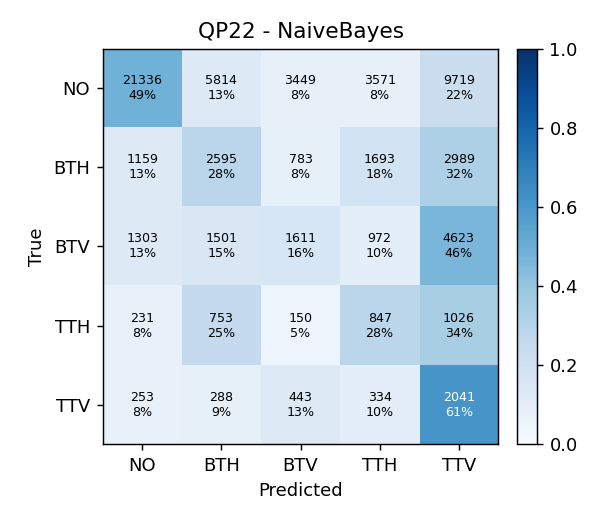

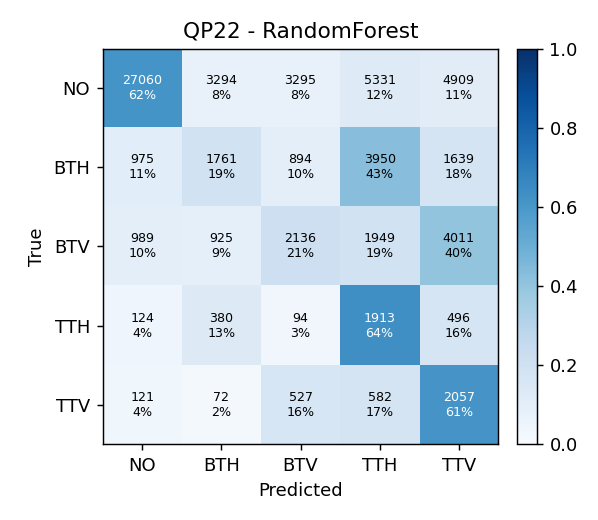

### QP27

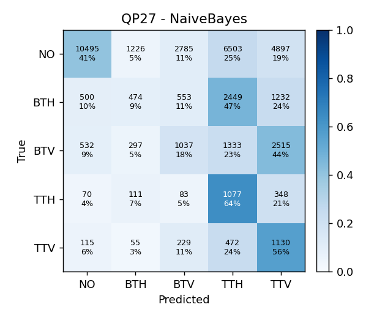
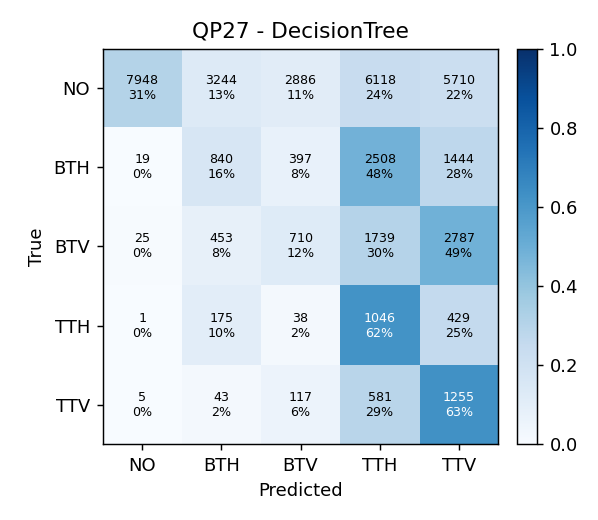
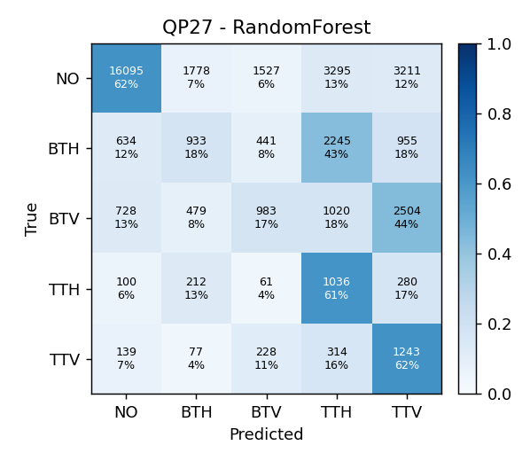

### QP32

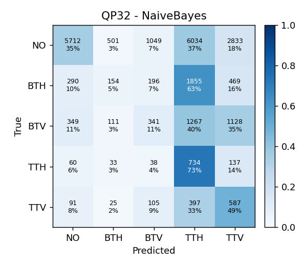
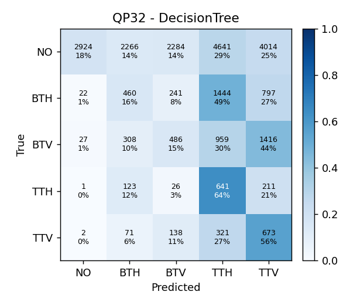
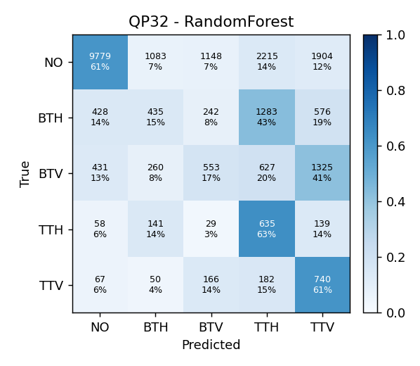

### QP37

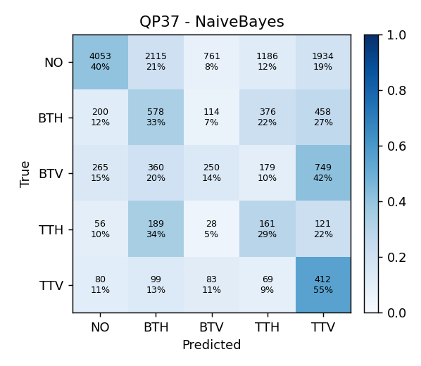
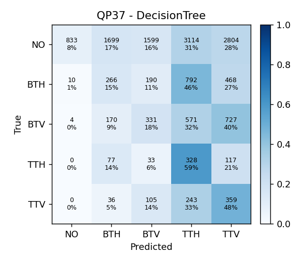
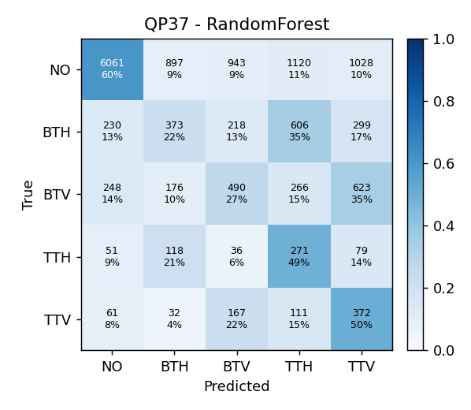

## 模型产物

- `mttForest.bin`（4 个 QP 的森林合一，格式 "QTF1"，与 QtForestPredictor 同），编码时单独加载用于 MTT 逐节点剪枝；
- 每 QP 元数据 `mttModels/QP<qp>.json`。
- 朴素贝叶斯仅作对照，不导出（森林 bin 只存树模型）。
